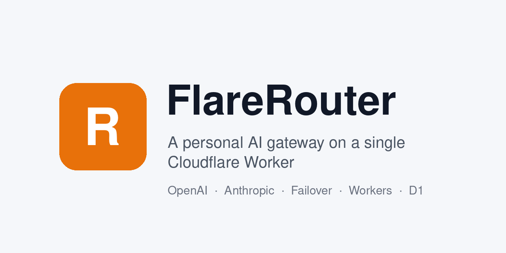

# FlareRouter

[简体中文](README.md) | 繁體中文 | [English](README.en.md)

部署在單一 Cloudflare Worker 上的個人 AI 閘道：同時提供 OpenAI 相容介面和 Anthropic Messages 介面，把多家服務商集中到一個網址、一把密鑰，失敗時自動切換到下一家。

[](https://github.com/HenryYannis/FlareRouter/actions/workflows/check.yml)
[](LICENSE)



為個人自用設計：沒有使用者系統、計費和配額，不需建置，管理頁拆成 HTML/CSS/JS 後由入口注入成單頁打進 Worker。錯誤訊息一律原文回傳、原文顯示，不做隱藏。

## 功能

- **服務商管理**：名稱、ID、協定類型（OpenAI 相容 / Anthropic）、Base URL、API Key（頁面只顯示遮罩後的預覽）、模型清單（可從服務商的 `/models` 拉取後勾選）、啟用、順序、逾時
- **OpenAI 相容介面**：`/v1/chat/completions`（串流 SSE 原樣轉送）、`/v1/embeddings`、`/v1/models`；圖片與語音：`/v1/images/generations`、`/v1/images/edits`、`/v1/audio/transcriptions`、`/v1/audio/speech`（TTS；對齊控制台閘道並補充合成，依模型找到服務商後原樣轉送）
- **Anthropic 介面**：`/v1/messages`（含串流）、`/v1/messages/count_tokens`，Claude Code 可直接接入
- **協定互轉**：兩種入口都能呼叫兩種協定的服務商，請求、回應、串流事件、工具呼叫自動轉換
- **模型定址**：`服務商 ID/模型`，例如 `openrouter/google/gemini-2.5-pro`；也可只寫模型名稱（在已啟用服務商的模型清單中尋找，不分大小寫）；寫 `auto` 則依容災鏈從頭嘗試
- **容災切換**：失敗（網路錯誤、逾時、任何非 2xx）就依容災鏈換下一個；串流請求只在上游開始回傳之前切換；請求標頭 `x-gateway-fallback: off` 可單次關閉，設定中也可整體關閉
- **呼叫密鑰**：以 `Authorization: Bearer`、`x-api-key` 或 `api-key` 驗證；管理頁可產生多把、隨時查看明文、一鍵複製、撤銷、刪除；D1 儲存明文與雜湊
- **呼叫日誌**：存在 D1，以 `ctx.waitUntil` 非同步寫入；可依狀態、容災、協定、服務商、密鑰、模型、錯誤關鍵字篩選，可清空；失敗的每次嘗試都記錄上游原始錯誤
- **管理頁**：同一個 Worker 的 `/admin`，以管理員密碼登入；概覽、服務商、容災、呼叫密鑰、日誌、測試、設定；原始碼在 `src/admin/`（`index.html`、`style.css`、`app.js`）；支援簡體/繁體/English 三語切換；日夜模式預設跟隨系統（與 FlarePanel 一致），可手動切換，含玻璃風格；「測試」支援多輪串流、思考過程摺疊與 Markdown（僅存本機瀏覽器）

## 部署

需要 Node.js 22+ 和一個 Cloudflare 帳號（免費方案即可）。

```bash
git clone https://github.com/HenryYannis/FlareRouter.git
cd FlareRouter
npm install
npx wrangler login

# 1. 建立 KV（服務商設定）：把輸出的 id 填入 wrangler.toml 的 [[kv_namespaces]]
npx wrangler kv namespace create flarerouter-config

# 2. 建立 D1（呼叫密鑰 + 日誌）：把輸出的 database_id 填入 wrangler.toml 的 [[d1_databases]]
npx wrangler d1 create flarerouter

# 3. 建立資料表
npm run db:migrate

# 4. 設定管理員密碼（互動輸入，不會寫入檔案）
npx wrangler secret put ADMIN_PASSWORD

# 5. 部署
npx wrangler deploy
```

預設部署到 `https://flarerouter.<你的子網域>.workers.dev`。想用自己的網域：在 `wrangler.toml` 中把 `workers_dev` 改成 `false`，取消 `routes` 的註解並填上網域（網域須在同一個 Cloudflare 帳號下），`wrangler deploy` 會自動建立 DNS 記錄和憑證；該子網域已有 DNS 記錄的話請先刪除。

部署後開啟 `https://你的網址/admin`，以管理員密碼登入：

1. 在「服务商」頁新增服務商（Base URL 通常以 `/v1` 結尾）。模型清單可留空儲存，再按「从服务商拉取」勾選寫入；勾選即時寫入
2. 在「容灾」頁依序排好容災鏈（留空則依服務商順序取每家的第一個模型）
3. 在「调用密钥」頁產生密鑰，明文只顯示一次
4. 在「測試」頁可多輪試聊（串流，走真實轉發/容災/日誌）；在「日誌」頁查看結果

（管理頁介面為簡體中文，上方引號內是頁面上實際顯示的名稱。）

之後更新程式碼只需 `npx wrangler deploy`；有新的資料庫遷移時再執行一次 `npm run db:migrate`（已執行過的遷移會自動略過）。

想推送即部署：Cloudflare 控制台 → Workers & Pages → 你的 Worker → 設定 → 建置，連結 GitHub 儲存庫的 `main`，部署指令填 `npx wrangler d1 migrations apply DB --remote && npx wrangler deploy`。

### 保留個人設定並跟隨上游更新（選用）

想把自己的 KV/D1 ID、網域提交到 Git 又不想公開時，可以建立一個私有儲存庫作為下游：

1. 私有儲存庫中只改 `wrangler.toml` 等個人設定，其餘檔案不動，以 `git merge` 合併本儲存庫的 `main`（不要 squash）
2. 在私有儲存庫加一個排程工作流程：`git fetch` 本儲存庫 → `git merge upstream/main` → 沒有衝突就推送，有衝突就開 issue
3. 想上游一更新就立即同步：在你的 fork 設定 Secrets `DOWNSTREAM_REPO`（如 `you/flarerouter-private`）和 `DOWNSTREAM_TOKEN`（對下游有 Contents 讀寫權限的細粒度 PAT），`.github/workflows/notify-downstream.yml` 會送出 `repository_dispatch`（類型 `flarerouter-updated`）；沒有設定這兩個 Secrets 時自動略過

## 設定

### wrangler.toml

| 項目 | 作用 |
| --- | --- |
| `[[kv_namespaces]]` `binding = "CONFIG"` | 服務商設定、各項設定、登入失敗次數；`id` 換成自己建立的 KV ID |
| `[[d1_databases]]` `binding = "DB"` | 呼叫密鑰、呼叫日誌；`database_id` 換成自己建立的 D1 ID，資料表結構在 `migrations/` |
| `workers_dev` / `routes` | 使用 workers.dev 子網域還是自己的網域 |
| `[triggers] crons = ["0 19 * * *"]` | 每天 UTC 19:00 依「日誌保留天數」清理舊日誌 |
| `[observability]` | Workers 日誌與可觀測性，預設開啟 |

### 機密與本機變數

唯一的機密是 `ADMIN_PASSWORD`（管理頁登入密碼）：

- 線上：`npx wrangler secret put ADMIN_PASSWORD`，不要寫入 `wrangler.toml`
- 本機：`cp .dev.vars.example .dev.vars`，把 `ADMIN_PASSWORD=change-me` 改成自己的密碼（`.dev.vars` 已列入 `.gitignore`）

未設定 `ADMIN_PASSWORD` 時無法登入管理頁。變更密碼會讓所有舊工作階段失效。

### 管理頁中的設定

服務商、容災鏈和以下設定都存在 KV 中，在管理頁修改：

- 容災開關（預設開啟）
- 日誌保留天數（預設 30，0 為永久保留）
- 是否記錄訊息原文（預設關閉，只記錄中繼資料）
- 每個服務商的逾時（預設 60 秒，最長 300 秒），以及串流時是否補上 `stream_options.include_usage`（預設開啟）

「设置 → 备份」可以匯出／匯入設定（匯出檔含上游 Key 明文，請妥善保管；匯入會整體覆蓋目前的服務商與設定）。

## 呼叫範例

### OpenAI 相容介面

```bash
# 列出模型
curl https://ai.example.com/v1/models \
  -H "Authorization: Bearer sk-gw-你的密鑰"

# 非串流
curl https://ai.example.com/v1/chat/completions \
  -H "Authorization: Bearer sk-gw-你的密鑰" \
  -H "Content-Type: application/json" \
  -d '{"model":"openrouter/google/gemini-2.5-pro","messages":[{"role":"user","content":"你好"}]}'

# 串流
curl -N https://ai.example.com/v1/chat/completions \
  -H "Authorization: Bearer sk-gw-你的密鑰" \
  -H "Content-Type: application/json" \
  -d '{"model":"auto","stream":true,"messages":[{"role":"user","content":"寫一句詩"}]}'

# 本次不容災（失敗直接回傳上游原始錯誤）
curl https://ai.example.com/v1/chat/completions \
  -H "Authorization: Bearer sk-gw-你的密鑰" \
  -H "x-gateway-fallback: off" \
  -H "Content-Type: application/json" \
  -d '{"model":"gemini/gemini-2.5-flash","messages":[{"role":"user","content":"hi"}]}'
```

在 Cherry Studio、Chatbox、Cursor 等用戶端中：API 位址填 `https://ai.example.com/v1`，密鑰填 `sk-gw-...`，模型填 `服務商 ID/模型` 或 `auto`。

回應標頭會帶上 `x-gateway-provider`、`x-gateway-model`、`x-gateway-attempts`、`x-gateway-fallback`、`x-gateway-protocol`，方便查看這次實際走了哪一家。
所有候選都失敗時，HTTP 狀態取最後一次上游的狀態碼（沒有則為 502），`error.message` 和 `error.attempts` 中有每一次嘗試的原始錯誤。

`GET /health` 不需要密鑰，回傳 `{"status":"ok","name":"flarerouter"}`，可用於存活檢查。

### Anthropic 介面

#### 新增 Anthropic 服務商

在管理頁「服务商 → 添加服务商」，協定類型選「Anthropic Messages」：

- Base URL：`https://api.anthropic.com`（帶不帶 `/v1` 都可以）
- API Key：`sk-ant-...`（閘道以 `x-api-key` 傳給上游；`anthropic-version` 預設為 `2023-06-01`，呼叫方有帶就沿用呼叫方的）
- 「从服务商拉取」會請求上游的 `/v1/models`

其他提供 Anthropic 相容介面的服務商也可以用這個類型新增。

#### 兩種入口 × 兩種上游

| 入口 | 上游是 Anthropic | 上游是 OpenAI 相容 |
| --- | --- | --- |
| `POST /v1/messages` | 原樣轉送（只換 model，`anthropic-version`、`anthropic-beta` 沿用呼叫方的） | 轉成 chat/completions，回應和串流轉回 Anthropic 事件 |
| `POST /v1/chat/completions` | 轉成 Messages，回應和串流轉回 OpenAI chunk | 原樣轉送 |

轉換涵蓋：system、多輪對話、圖片（base64 / URL）、tools / tool_use / tool_result、tool_choice、stop_reason ⇄ finish_reason、usage（含快取命中）。
容災鏈對兩種入口都有效，可以跨協定切換（例如 Claude 官方 529 過載 → 換到 OpenRouter 上的模型），串流開始回傳後不再切換。
回應標頭 `x-gateway-protocol` 顯示這次是 `入口->上游`，例如 `anthropic->openai`；日誌中也會記錄入口協定和上游協定。

`/v1/messages/count_tokens`：上游是 Anthropic 時直接轉送；上游是 OpenAI 相容時回傳本機估算（回應標頭 `x-gateway-estimated: 1`）。

錯誤依入口協定的格式回傳（`/v1/messages` 回傳 `{"type":"error","error":{...}}`），`message` 中保留上游原始錯誤。

```bash
curl https://ai.example.com/v1/messages \
  -H "x-api-key: sk-gw-你的密鑰" \
  -H "anthropic-version: 2023-06-01" \
  -H "Content-Type: application/json" \
  -d '{"model":"auto","max_tokens":256,"messages":[{"role":"user","content":"你好"}]}'
```

#### 接入 Claude Code

```bash
export ANTHROPIC_BASE_URL=https://ai.example.com
export ANTHROPIC_AUTH_TOKEN=sk-gw-你的呼叫密鑰
# 指定模型（Claude Code 預設會送出 claude-sonnet-… 這類官方名稱，閘道找不到就會回傳 404）
export ANTHROPIC_MODEL=anthropic/claude-sonnet-4-5                # 服務商 ID/模型，或 auto
export ANTHROPIC_DEFAULT_HAIKU_MODEL=anthropic/claude-haiku-4-5   # 背景小任務用的快速模型
claude
```

也可以寫入 `~/.claude/settings.json`：

```json
{
  "env": {
    "ANTHROPIC_BASE_URL": "https://ai.example.com",
    "ANTHROPIC_AUTH_TOKEN": "sk-gw-你的呼叫密鑰",
    "ANTHROPIC_MODEL": "anthropic/claude-sonnet-4-5",
    "ANTHROPIC_DEFAULT_HAIKU_MODEL": "anthropic/claude-haiku-4-5"
  }
}
```

- 上面的 `anthropic` 是你在管理頁為服務商取的 ID，請換成自己的；模型也可以指向 OpenAI 相容的服務商（如 `openrouter/google/gemini-2.5-pro`），閘道會自動轉換協定。
- 用 `ANTHROPIC_API_KEY` 取代 `ANTHROPIC_AUTH_TOKEN` 也可以（送出的是 `x-api-key` 標頭），閘道兩種都接受。
- 也可以不設 `ANTHROPIC_MODEL`，而是把 Claude Code 送出的官方模型名稱（如 `claude-sonnet-4-5`）直接寫入某個服務商的模型清單，閘道會依模型名稱比對。

## 本機開發與自我測試

```bash
cp .dev.vars.example .dev.vars          # 改成本機用的管理員密碼
npm run db:migrate:local
npx wrangler dev                         # http://localhost:8787/admin

npm test                                 # Miniflare 自我測試（假 OpenAI + 假 Anthropic 上游）：驗證、轉送、協定互轉、串流、容災、日誌、Cron 清理等
npm run check                            # wrangler deploy --dry-run
```

GitHub Actions（`.github/workflows/check.yml`）會在每次 PR 和推送到 `main` 時執行：語法檢查、`npm test`、`npm run check`、gitleaks 密鑰掃描。

## 說明與限制

- 請求內容除了 `model` 換成上游的實際模型名稱，其餘欄位原樣轉送；串流請求預設補上 `stream_options.include_usage`（某個服務商不接受的話，可在編輯中關閉）。
- 上游沒有回傳 usage 時，token 數依字數粗略估算。
- 逾時只計算到上游回傳回應標頭為止，之後的串流輸出不限時長。
- 服務商設定在每個 Worker 執行個體中快取 30 秒；呼叫密鑰驗證快取 30 秒（撤銷後，其他執行個體最多 30 秒後生效）。
- 管理員登入：連續 10 次密碼錯誤會依 IP 鎖定 15 分鐘；工作階段 7 天，Cookie 為 HttpOnly + Secure + SameSite=Strict。
- 日誌預設保留 30 天，每天 UTC 19:00 由 Cron 清理；預設不記錄訊息原文。
- 圖片生成 / 編輯、語音辨識 / TTS 與 chat、embeddings、messages 一樣走呼叫密鑰驗證，依模型解析服務商後原樣轉送（支援容災）；Anthropic 協定的服務商不接 embeddings 與媒體介面（容災時自動略過）。請求體預設上限 25MB，媒體逾時預設 120 秒（可用環境變數 `MAX_MEDIA_BYTES`、`MEDIA_TIMEOUT_MS` 調整）。不支援 Cloudflare Workers AI 綁定。
- 協定互轉的限制：
  - Anthropic → OpenAI：`thinking`（延伸思考）、`cache_control`、`top_k`、伺服器端工具（web_search 等）、引用（citations）會被捨棄；OpenAI 上游回傳的 `reasoning_content` 不轉成 thinking 區塊（避免下一輪帶著沒有簽章的 thinking 傳回 Anthropic 而出錯）；PDF 文件轉成 OpenAI `file` 片段，上游不支援時會報錯。
  - OpenAI → Anthropic：未傳 `max_tokens`（或 `max_completion_tokens`）時預設 8192；`temperature` 限制在 0–1；`n`、`logprobs`、`response_format`、`seed` 等 Anthropic 沒有的參數不轉送；thinking 區塊轉成 `reasoning_content`。
  - 跨協定時命中 `stop_sequence` 會回報為一般結束（OpenAI 不區分）。
  - 工具的 JSON Schema 原樣轉送；部分 OpenAI 相容服務商對 Schema 較挑剔（如不接受 `$schema`、`format`），用 Claude Code 呼叫這類上游時可能回傳 400，錯誤原文會直接顯示。
- `/v1/messages/count_tokens` 不寫入呼叫日誌；上游為 OpenAI 時是粗略估算。

## 相關專案

- [FlarePanel](https://github.com/HenryYannis/FlarePanel)：Cloudflare Pages 多站點管理後台，管理留言、瀏覽量、會員帳號和 R2 檔案，同樣不需建置、純 Cloudflare 部署。

## 授權條款

[MIT](LICENSE) © 2026 程小宝
